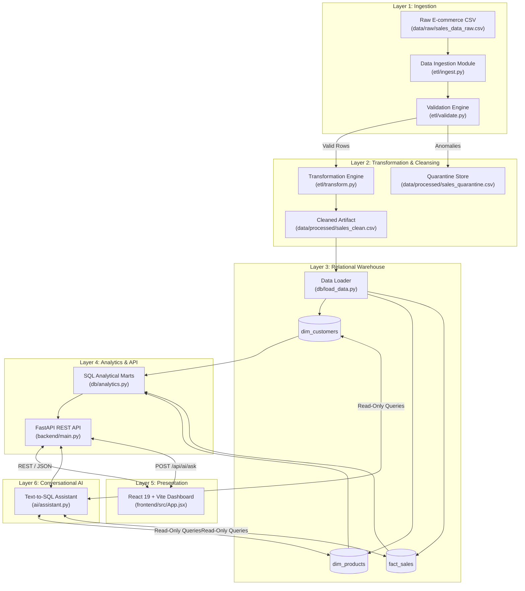

# DataPulse System Architecture & Technical Specifications

**Platform**: DataPulse — Intelligent Data Engineering & Analytics Platform  
**Target Environment**: Windows / Linux / macOS (100% Free & Open-Source)  

---

## 1. High-Level Architectural Flow

---

## 2. Layer Specifications

### Layer 1: Ingestion & Schema Validation
* **Ingestion (`etl/ingest.py`)**: Reads flat files, monitors memory footprint, and verifies column headers.
* **Validation (`etl/validate.py`)**: Enforces:
  * Primary key completeness (`order_id`, `customer_id`, `product_id`).
  * Domain rules: `quantity > 0`, `unit_price > 0`.
  * Allowed enum values: `order_status`, `payment_method`.
  * Separates valid records from quarantined anomalies (`sales_quarantine.csv`).

### Layer 2: Transformation (`etl/transform.py`)
* Strips inconsistent whitespace.
* Imputes non-critical nulls (e.g., missing customer email -> synthetic placeholder).
* Calendar dimensional extraction: `order_year`, `order_month`, `order_quarter`, `order_day_name`.
* Financial feature engineering:
  * $\text{gross\_amount} = \text{unit\_price} \times \text{quantity}$
  * $\text{discount\_amount} = \text{gross\_amount} \times \text{discount\_percent}$
  * $\text{net\_amount} = \text{gross\_amount} - \text{discount\_amount}$
  * $\text{estimated\_cogs} = \text{unit\_price} \times 0.65 \times \text{quantity}$
  * $\text{estimated\_profit} = \text{net\_amount} - \text{estimated\_cogs}$

### Layer 3: Relational Star Schema (`db/models.py`)
* **`dim_customers`**: Unique buyer records normalized across all orders.
* **`dim_products`**: Catalog dimension with unit pricing and product categories.
* **`fact_sales`**: Transactional facts with foreign keys, composite indexes, and monetary metrics.
* **Storage Engine**: Dual-mode connection manager (`db/connection.py`) defaulting to SQLite (`data/datapulse.db`) and switching seamlessly to PostgreSQL when `DATABASE_URL` is set in `.env`.

### Layer 4: Analytics & REST API (`backend/main.py`)
* **Query Engine (`db/analytics.py`)**: Executes complex SQL queries including multi-table JOINs and window functions (`RANK()`, `SUM() OVER ()`).
* **API Framework**: FastAPI with CORS middleware, healthcheck, and auto-generated Swagger documentation at `/docs`.

### Layer 5: Frontend Dashboard (`frontend/`)
* Built with **React 19** and **Vite**.
* Features: Responsive Glassmorphism UI, interactive SVG charts, dynamic KPI meters, and automatic live API polling via configurable `VITE_API_URL` with snapshot fallback.

### Layer 6: Conversational AI Assistant (`ai/assistant.py`)
* **Architecture**: 100% local, zero-token cost rule-based semantic NLP query router and Text-to-SQL compiler.
* **Supported Query Handling**: Maps natural-language business questions to parameterized SQL queries across:
  * Executive KPIs & Revenue (`EXECUTIVE_KPIS`)
  * Top-selling products and categories (`TOP_PRODUCTS`)
  * Regional performance & profit margins (`REGIONAL_PERFORMANCE`)
  * Customer lifetime value & spend rankings (`CUSTOMER_CLV`)
  * Payment method adoption and cancellation metrics (`PAYMENT_METHOD`)
  * Monthly trends and cumulative growth curves (`MONTHLY_TRENDS`)
* **Database Interaction**: Executes strictly read-only `SELECT` queries against the relational Star Schema.
* **Unsupported & Destructive Query Protection**:
  * Blocks any queries containing modification keywords (`DROP`, `DELETE`, `TRUNCATE`, `ALTER`, `UPDATE`, `INSERT`) with an explicit safety notice.
  * Rejects irrelevant queries (e.g., weather, chit-chat) with an `UNSUPPORTED_QUERY` intent code, returning helpful domain sample questions rather than defaulting to revenue data.
