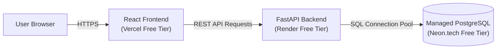

# DataPulse Zero-Cost Deployment Guide

Deploy the **DataPulse** platform to the cloud at **₹0 cost** using free-tier services from modern developer platforms.

**GitHub Repository**: [https://github.com/Manoj-git17/DataPulse](https://github.com/Manoj-git17/DataPulse)

---

## 1. Cloud Architecture Overview (Free Tier)



| Service | Component | Free Tier Provider | Monthly Cost |
| :--- | :--- | :--- | :--- |
| **Database** | Managed PostgreSQL Instance | [Neon.tech](https://neon.tech) or [Supabase.com](https://supabase.com) | **₹0** (Free managed Postgres with pooling) |
| **Backend API** | FastAPI ASGI Service | [Render.com](https://render.com) or [Railway.app](https://railway.app) | **₹0** (750 compute hours/month) |
| **Frontend UI** | React 19 (Vite) Single Page App | [Vercel.com](https://vercel.com) or [Netlify.com](https://netlify.com) | **₹0** (100GB bandwidth, free global CDN & SSL) |

---

## 2. Step-by-Step Free Cloud Deployment

### Step A: Provision Free Managed PostgreSQL Database
1. Go to [Neon.tech](https://neon.tech) (or [Supabase.com](https://supabase.com)) and sign up for a free account with GitHub.
2. Click **Create Project**, name it `datapulse`, and select the region closest to you.
3. In the dashboard, copy your pooled connection string:
   ```text
   postgresql://[user]:[password]@[host]/datapulse?sslmode=require
   ```

---

### Step B: Seed Cloud Database with Initial Data
Run the automated ETL and database loader locally once, pointing to your cloud PostgreSQL database to initialize tables and seed transactions:

```powershell
# Set temporary environment variable in PowerShell
$env:DATABASE_URL="postgresql://[user]:[password]@[host]/datapulse?sslmode=require"

# Initialize Star Schema tables and load clean data into PostgreSQL
python -m db.load_data
```
*(Verify output shows: `Dimensions Loaded: 10 Customers, 10 Products | Fact Rows Loaded: 148 Sales Transactions`)*

---

### Step C: Deploy FastAPI Backend (Render)
1. Go to [Render.com](https://render.com) and sign in with GitHub.
2. Click **New +** $\rightarrow$ **Web Service**.
3. Select your repository: `Manoj-git17/DataPulse`.
4. Configure the build and start settings:
   * **Name**: `datapulse-api`
   * **Region**: Same region as your Neon database (e.g., Singapore / Frankfurt / US East)
   * **Branch**: `main`
   * **Root Directory**: `.` *(leave empty or set to dot)*
   * **Runtime**: `Python 3`
   * **Build Command**: `pip install -r requirements.txt`
   * **Start Command**: `python -m uvicorn backend.main:app --host 0.0.0.0 --port 10000`
5. Under **Environment Variables**, click **Add Environment Variable**:
   * **Key**: `DATABASE_URL`
   * **Value**: Your PostgreSQL connection string from Step A.
6. Click **Create Web Service**.
7. Once deployed, copy your live API URL (e.g., `https://datapulse-api.onrender.com`).
   * Test it by visiting: `https://datapulse-api.onrender.com/docs` to see the live Swagger UI!

---

### Step D: Deploy React Frontend (Vercel)
1. Go to [Vercel.com](https://vercel.com) and sign in with GitHub.
2. Click **Add New...** $\rightarrow$ **Project**.
3. Import your repository: `Manoj-git17/DataPulse`.
4. Configure project settings:
   * **Framework Preset**: `Vite`
   * **Root Directory**: `frontend` *(Click Edit and select the `frontend` folder)*
   * **Build Command**: `npm run build`
   * **Output Directory**: `dist`
5. Expand **Environment Variables** and add:
   * **Key**: `VITE_API_URL`
   * **Value**: Your Render live backend URL from Step C (e.g., `https://datapulse-api.onrender.com`).
     *(Note: Do not include a trailing slash).*
6. Click **Deploy**.
7. In ~30 seconds, your dashboard will be live at a public URL (e.g., `https://datapulse-frontend.vercel.app`)!

---

## 3. Local Containerized Deployment (Docker Compose)

If you prefer to run the full stack in local containers with an isolated PostgreSQL database:

```powershell
# 1. Build and start PostgreSQL, FastAPI, and React in background
docker compose up --build -d

# 2. View running containers
docker compose ps
```

* **Frontend Dashboard**: [http://localhost:3000](http://localhost:3000)
* **Backend API Swagger**: [http://localhost:8000/docs](http://localhost:8000/docs)
* **PostgreSQL Port**: `localhost:5432`

To stop the containers:
```powershell
docker compose down
```

---

## 4. Verification & Troubleshooting Checklist

| Check | Expected Result | Solution if Failed |
| :--- | :--- | :--- |
| **API Health Check** | `GET /api/health` returns `{"status": "healthy", "database": {"status": "connected"}}` | Verify `DATABASE_URL` in Render environment variables. |
| **Frontend Live Pill** | Shows green `Live FastAPI Backend` pill | Check browser DevTools network tab; confirm `VITE_API_URL` in Vercel is set to your Render URL. |
| **CORS Policy** | Browser does not block cross-origin requests | Backend has `CORSMiddleware` configured with `allow_origins=["*"]`. |
